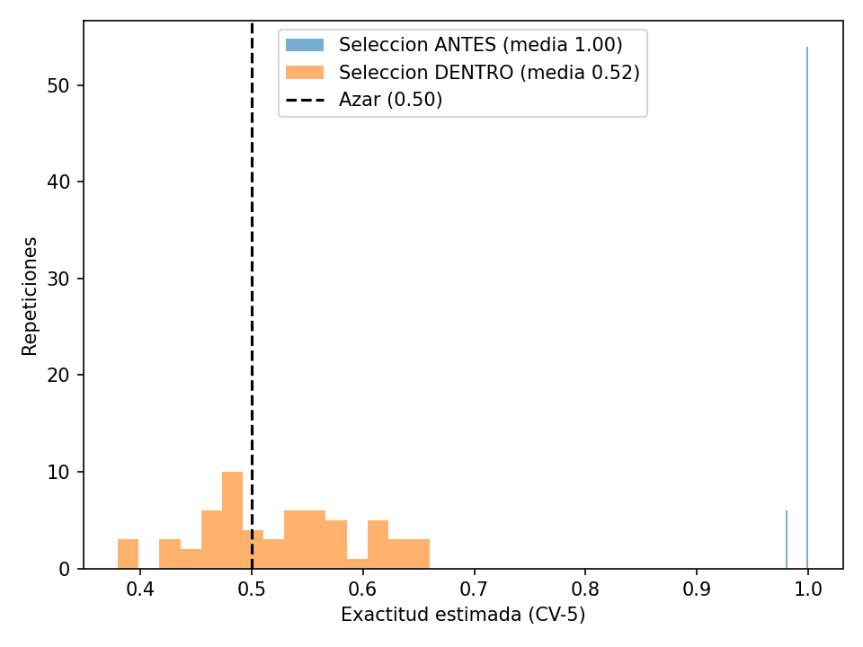

# Problema 1 — El reporte demasiado bueno

> **Karol Burrola Torres · Semilla: 223210891 · a = 1 · b = 9 · k = 11 · RandomForest (b mod 3 = 0)**

---

## Reproducir
```bash
pip install scikit-learn pandas numpy matplotlib
cd problema-1
python codigoejemplo.py        
python codigocorrecciones.py   
python codigohonesto.py        
python codigoruido.py          
```
> Los datos se descargan solos desde UCI en cada script y la carpeta `resultados/` se crea sola al correr.

---

## (a) Reproducción (`codigoejemplo.py`)
Base consultora: Profundidad None, **acc = 0.913, AUC = 0.970**.

---

## (b) Problemas encontrados (Se imprimen al inicio de `codigocorrecciones.py`)
| # | Problema | Tipo | Por qué infla |
|---|----------|------|---------------|
| 1 | Duplicar positivos 6 veces ANTES del split | Fuga por muestra | 99.99% de positivos de prueba tiene gemelo en train; El bosque memoriza |
| 2 | `StandardScaler` ajustado con todos los datos | Fuga de preproceso | La prueba aporta media/varianza al train |
| 3 | `SelectKBest(k=11)` ajustado con todos los datos | Mala práctica validación | Se elige con las etiquetas de prueba |
| 4 | Elegir profundidad con la prueba (4 modelos) | Reúso de prueba | El ganador gana en parte por suerte |
| 5 | Usar `duration` | Fuga de información | Solo se conoce al colgar, una pre-llamada no existe |
| 6 | Split al azar ignorando cronología 2008–2010 | Mala validación temporal | Mezcla 2008-2010 |
| 7 | Reportar accuracy sin intervalo en desbalance | Métrica pobre | No mide priorizar a quién llamar |

---

## (c) Medición (`codigocorrecciones.py` → `tablacomparativa.csv`, prof fija=8 salvo base)
| Variante | acc | AUC | Lectura |
|---|---|---|---|
| Codigo_consultora | 0.913 | 0.970 | — |
| 1_Sin_duplicar | 0.903 | 0.906 | Las copias inflan AUC ~6 pp |
| 2_3_Preproceso_train_dup | 0.821 | 0.904 | Scaler/select fuera casi no pesan con n grande |
| 4_Validacion_Interna | 0.913 | 0.970 | Con n=15k el sesgo de elegir 4 es ~0.5 pp (teoría b) |
| 5_Sin_duration | 0.810 | 0.752 | **Pesa más**: duration explica ~22 pp de AUC |
| 6_Temporal_con_dup | 0.749 | 0.815 | El tiempo sí mueve el número |
| 7_Juntar_temporal | 0.717 | 0.703 | Honesto simple |
| 7b_Juntar_azar | 0.810 | 0.752 | Azar > temporal |

---

## (d) Versión honesta (`codigohonesto.py`)
Sin trampas: Nada se ajusta con la prueba, no se fotocopia nada y la profundidad se elige solo con el train. Se prueba de dos formas: por tiempo (último 20% como próxima campaña,
la principal) y al azar (diagnóstico). Como solo el 12% contrata, lo que importa no es la accuracy sino el orden: A quién llamar primero.
| Split | Mejor prof | Acc | AUC IC95 | AP | Precision_top10 |
|---|---|---|---|---|---|
| Temporal | 4 | 0.525 | 0.717 [0.706, 0.728] | 0.517 | 0.586 |
| Azar | 8 | 0.667 | 0.744 [0.727, 0.761] | 0.366 | 0.438 |

Resumido: Llamando al 10% con más puntaje, contratan 44–59 de cada 100, contra 12–32 llamando al azar.

---

## (e) Ruido (`codigoruido.py` → `ruido.png`)
Con 50 datos y 5000 variables de puro ruido se eligen las 65 "mejores" de dos formas: Antes de validar (mal) y dentro de cada validación (bien), 60 veces. Antes sale 0.998 y dentro 0.525 (el azar es 0.50), es decir, elegir con todos los datos y luego validar miente hasta con basura.

<p align="center">
  
  <br />
  <em>Selección ANTES (mal) vs DENTRO (bien): Con pura basura, seleccionar fuera da 100%.</em>
</p>
