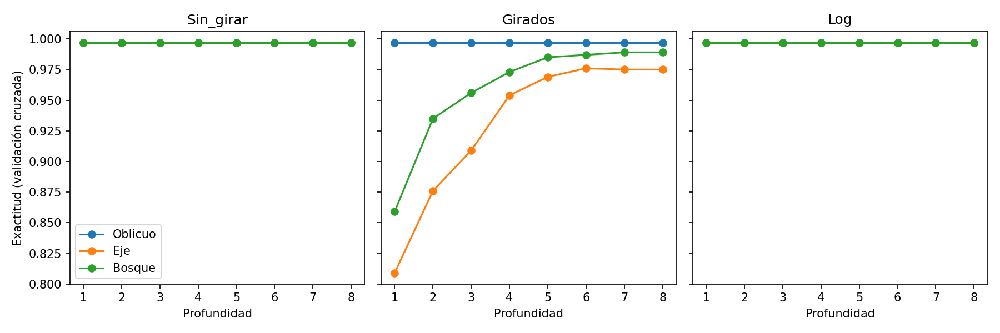

# Problema 2 — Árboles que cortan en diagonal

> **Karol Burrola Torres · Semilla: 223210891 · a = 1, b = 9 **
>
> Datos reales: a mod 4 = 1 → cáncer de mama (WDBC, maligno M = 1, 569 filas, 37% positivas).
> Ángulo (b): 10 + 5·9 = 55 grados.

---

## Reproducir
```bash
pip install scikit-learn pandas numpy matplotlib
cd problema-2
python arbol_oblicuo_a.py             
python codigo_girar_transformar_b.py  
python codigo_datos_reales.py        
python codigo_conclusiones.py        
```
> Los datos reales se descargan solos del UCI y la carpeta `resultados/` se crea sola al correr.

---

## (a) Mi árbol (`arbol_oblicuo_a.py`)
Un árbol como el normal, pero en cada nodo también prueba cortar en diagonal con la
dirección de Fisher y se queda con el corte (diagonal o de eje) que deje los grupos más
puros. La prueba con los 6 puntos del examen pasa: encuentra la diagonal y no falla ninguno.

---

## (b) Girar y transformar (`rotacion.csv`, `rotacion.png`)
1000 puntos con clase según x1 > 0.2; luego Girados 55° y con Log en x1. Profundidad 1–8.
| Datos | Oblicuo prof 1 → 8 | Eje prof 1 → 8 | Bosque prof 1 → 8 |
|---|---|---|---|
| Sin_girar | 0.997 → 0.997 | 0.997 → 0.997 | 0.997 → 0.997 |
| Girados | 0.997 → 0.997 | 0.809 → 0.975 | 0.859 → 0.989 |
| Log | 0.997 → 0.997 | 0.997 → 0.997 | 0.997 → 0.997 |

Sin_girar la frontera es fácil y todos llegan a lo mismo. Girados, el mío no se mueve
mientras el de ejes empieza en 0.81 y necesita hacerse profundo para recuperar: girar
sí afecta al de ejes y no al oblicuo. Con Log nadie cambia, porque mi árbol termina
eligiendo el corte de eje y ese no le teme al logaritmo.

<p align="center">
  
  <br />
  <em>Girados: el oblicuo plano en 0.997, el de ejes sube con la escalera.</em>
</p>

---

## (c) Datos reales (`reales.csv`, métrica AUC por 37% positivas, Prof por CV)
| Modelo | Prof | Acc | AUC | Hojas | Tiempo |
|---|---|---|---|---|---|
| Oblicuo | 2 | 0.960 | 0.970 | 4 | ~1.3s |
| Eje | 2 | 0.928 | 0.954 | 4 | 0.01s |
| Bosque | 5 | 0.956 | 0.990 | — | ~0.6s |
| Bagging_oblicuo | 2 | 0.972 | 0.994 | — | ~6s |

Decisiones: Métrica AUC (el 37% desbalancea la accuracy) + Acc de apoyo; Prof elegida por
validación cruzada barriendo 1–8 por modelo (el bagging hereda la del oblicuo). El Oblicuo
supera al Eje con las mismas 4 hojas; el bagging de oblicuos gana a todo. Los bosques no
tienen hojas porque son muchos árboles, no uno solo.

---

## (d) Cuándo vale la pena (`codigo_conclusiones.py`)
| Datos | Oblicuo | Eje |
|---|---|---|
| Diagonal | 0.994 | 0.904 |
| Ejes | 0.998 | 0.998 |

Gana donde la frontera es diagonal o las variables están correlacionadas. Empata donde la
frontera ya es de ejes, gracias a que compite contra el corte de eje. En mis datos no
perdió (0.970 vs 0.954): El cáncer trae variables correlacionadas tipo diagonal, y este
experimento lo pone a prueba.
